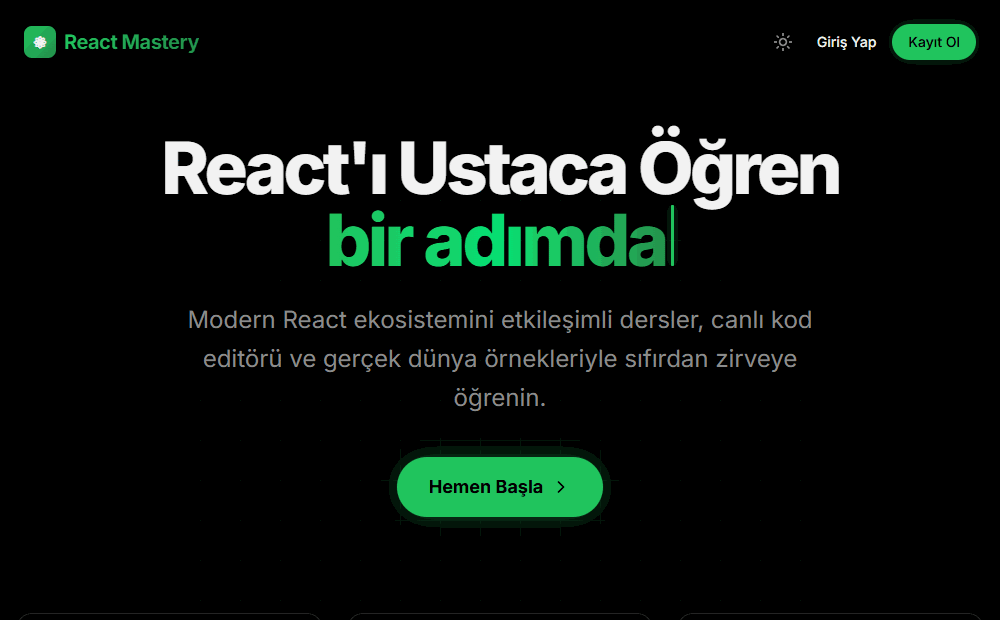

<div align="center">


# React Mastery


<p>
  
  
  
  
</p>

<a href="#-english"><b>🇬🇧 English</b></a> · <a href="#-türkçe"><b>🇹🇷 Türkçe</b></a>

</div>

<br>

<table align="center">
  <tr>
    <td align="center" width="25%"><br><b>20 lessons</b><br><sub>3 tracks</sub></td>
    <td align="center" width="25%"><br><b>Live code</b><br><sub>playground</sub></td>
    <td align="center" width="25%"><br><b>Quizzes</b><br><sub>every lesson</sub></td>
    <td align="center" width="25%"><br><b>Certificate</b><br><sub>on completion</sub></td>
  </tr>
</table>

##  Demo

<div align="center">
  <br><sub>Landing page → lesson list → a lesson → profile & badges</sub>
</div>

---

## 🇬🇧 English

> **Course:** React · Week 3 assignment

###  About the Project
**React Mastery** is a web platform for learning the React ecosystem from scratch to advanced level through interactive lessons, a live code editor and real-world examples. The lesson content is in Turkish.

###  Key Features
* 📚 **20 lessons in 3 tracks:** Core Concepts (8), Hooks (6) and Advanced (6).
* 💻 **Live playground:** Each lesson has a code example, a hands-on task and its expected output.
* ❓ **Quizzes:** Multiple-choice questions at the end of every lesson.
* 👤 **Profile & progress:** Sign-up/login pages and a profile page; progress is kept in the browser (`localStorage`).
* 🏅 **Certificate:** A completion certificate page once the course is finished.
* 🌗 **Light/dark theme** and smooth page transitions with Framer Motion.

###  Tech Stack
React · TypeScript · Vite · React Router · Tailwind CSS · Radix UI (shadcn/ui) · Framer Motion

###  Running
```bash
npm install
npm run dev
```
Then open the address Vite prints (usually `http://localhost:5173`).

---

## 🇹🇷 Türkçe

> **Ders:** React · 3. hafta ödevi

###  Proje Hakkında
**React Mastery**, React ekosistemini etkileşimli dersler, canlı kod editörü ve gerçek dünya örnekleriyle sıfırdan zirveye öğrenmek için hazırlanmış bir web platformudur.

###  Temel Özellikler
* 📚 **3 bölümde 20 ders:** Temel Kavramlar (8), Hook'lar (6) ve İleri Seviye (6).
* 💻 **Canlı kod alanı:** Her derste kod örneği, uygulamalı görev ve beklenen çıktı.
* ❓ **Quizler:** Her dersin sonunda çoktan seçmeli sorular.
* 👤 **Profil ve ilerleme:** Kayıt/giriş ve profil sayfaları; ilerleme tarayıcıda (`localStorage`) saklanır.
* 🏅 **Sertifika:** Kurs tamamlandığında bitirme sertifikası sayfası.
* 🌗 **Açık/koyu tema** ve Framer Motion ile akıcı sayfa geçişleri.

###  Teknoloji Yığını
React · TypeScript · Vite · React Router · Tailwind CSS · Radix UI (shadcn/ui) · Framer Motion

###  Çalıştırma
```bash
npm install
npm run dev
```
Ardından Vite'ın yazdığı adresi açın (genellikle `http://localhost:5173`).


<br>

<div align="center">
  
  <sub>Made by <a href="https://github.com/huseyinbaranisik">Hüseyin Baran Işık</a> · Animated emojis: <a href="https://github.com/Tarikul-Islam-Anik/Animated-Fluent-Emojis">Animated Fluent Emojis</a></sub>
</div>
